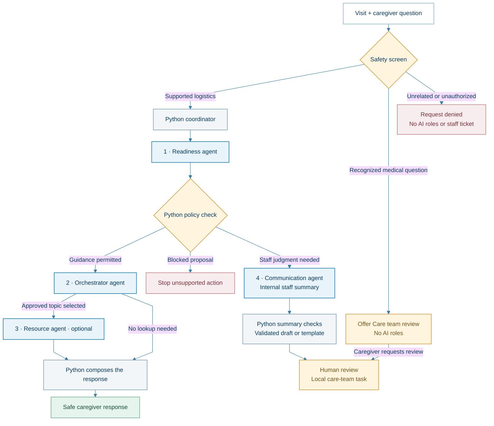

# VisitReady

**Helping families get ready for appointments.**


VisitReady is a Python and Streamlit portfolio prototype that helps a caregiver
identify unresolved appointment-preparation needs, find sourced public logistics
guidance, and request care-team review. A Python coordinator connects four
conditional AI roles and enforces the workflow's rules.

> **Portfolio prototype:** all appointment and patient examples are fictional.
> Review tickets stay in a local queue; no hospital system or live care team is connected.

[Get started](#quick-start) · [Workflow](#how-it-works) · [AI roles](#the-four-ai-roles) · [Tests](#run-the-tests) · [Technical notes](docs/WORKFLOW.md)

## The problem

An appointment can be scheduled while important preparation remains unresolved:
a ride is uncertain, paperwork is unclear, or the caregiver does not know where
to park. A calendar entry alone does not explain what still needs attention.

VisitReady explores a clearer preparation experience: answer supported logistics
questions from curated public guidance, preserve uncertainty, and make reported
needs visible for follow-up. It has not been evaluated for reducing missed visits.

## What it does

- Shows a fictional patient profile, appointment location, and preparation checklist.
- Uses the scheduled location to return curated parking addresses and source links.
- Uses AI to interpret supported logistics questions and propose structured steps.
- Drafts evidence-linked staff summaries for eligible logistics-review cases.
- Offers an explicit review-request button for recognized medical questions;
  those questions bypass all AI roles.
- Denies recognized unrelated or unauthorized requests without a model call or ticket.
- Provides separate caregiver, staff-queue, and run-history screens.

## How it works



Python controls the sequence, validates outputs, and enforces tool permissions.
The roles run conditionally: a parking request typically uses three AI roles,
while a lost-ride review typically uses two. Recognized medical and denied
requests make no model calls.

## The four AI roles

| Role | Responsibility | Boundary |
| --- | --- | --- |
| **Readiness** | Interpret supported logistics input and propose a structured next step or reported checklist change. | Proposals must pass Python policy checks. |
| **Orchestrator** | Recommend whether an approved public-information topic is relevant. | Selects from a bounded topic catalog. |
| **Resource** | Select an approved guidance tool call for the requested topic. | Uses curated guidance rather than unrestricted web browsing. |
| **Communication** | Draft an internal logistics summary with exact supporting quotes and unresolved items. | Cannot contact staff, book assistance, approve actions, or decide the review route. |

These are separate model-call roles in application code, using the same configured
API client settings. They are not separately trained models. Splitting the roles
makes responsibilities and failures easier to inspect, with additional calls and
latency on the paths that use them.

## Technology

| Technology | Purpose |
| --- | --- |
| Python | Coordination, policy checks, tools, and local persistence |
| OpenAI Python SDK | Model calls with typed structured outputs |
| Streamlit | Caregiver interface, staff workspace, and run history |
| Pydantic | Schemas and validation for inputs, proposals, and summaries |
| JSON | Fictional appointment fixtures, curated guidance, and local state |
| python-dotenv | Local API configuration |
| pytest + Streamlit AppTest | Automated workflow and interface checks |

The project uses an existing model through an API. JSON fixtures provide application
context; they are not training data. No model training, vector database, or separate
web API server is required.

## Quick start

Developed and verified with **Python 3.12**. Run commands from this folder.

### Windows PowerShell

```powershell
py -3.12 -m venv .venv
.\.venv\Scripts\python.exe -m pip install -r requirements.txt
Copy-Item .env.example .env
```

Edit your local `.env` file and replace both placeholders:

```dotenv
OPENAI_API_KEY=replace-with-your-own-key
OPENAI_MODEL=replace-with-your-model-id
```

Use an API model ID available to your account that supports the structured-output
calls used by this project. If you already run VisitReady, reuse your working model
setting locally. The model is configured by this file, not by your ChatGPT selection.
Your private `.env` is deliberately excluded from this source package and from Git.

Start the app:

```powershell
.\.venv\Scripts\python.exe -m streamlit run app.py --server.port 8502
```

Open **http://localhost:8502/**. Keep the terminal open while using the app.
After creating `.venv`, Windows users can also use `Restart_VisitReady.cmd`.

### macOS / Linux

```sh
python3.12 -m venv .venv
.venv/bin/python -m pip install -r requirements.txt
cp .env.example .env
# Edit .env before asking questions that call the model.
.venv/bin/python -m streamlit run app.py --server.port 8502
```

The restart shortcut is Windows-specific; use the direct command on other systems.

## Try the workflow

| Request | Expected path |
| --- | --- |
| "Where can I find parking?" | Readiness, policy check, Orchestrator, then Resource if the topic is selected; Python composes sourced guidance using the appointment location. |
| "My ride fell through." | Readiness and policy check, then Communication drafts an internal staff summary; a local follow-up task is created. |
| "What medicine should my child take?" | Recognized medical wording bypasses all AI roles. Select **Care team review** to create an appointment-linked ticket in the local staff queue. |
| "Solve this equation for me." | Recognized unrelated request is refused before model calls; no staff task is created. |

The four roles do **not** all run for every question. AI summaries remain drafts;
the staff view preserves the original report and evidence for comparison.

## Run the tests

The automated tests use controlled model responses and temporary queues. They do
not require an API key or make paid API requests:

```powershell
.\.venv\Scripts\python.exe -m pytest -q -p no:cacheprovider --ignore=runtime .
```

On macOS / Linux, replace the Python executable with `.venv/bin/python`.

The packaged copy passed **119 core test cases**. The **11 interface test cases**
are included but could not complete in the restricted packaging environment.
See [package verification](docs/VALIDATION.md) for the exact scope and limitation.

List evaluation scenarios without model calls:

```powershell
.\.venv\Scripts\python.exe evaluate.py
```

Optional live evaluation **makes paid model calls** using your local configuration:

```powershell
.\.venv\Scripts\python.exe evaluate.py --live --repeat 2
```

Generated queues, history, saved checklist changes, and evaluation results go into
`runtime/`, which is created as needed and excluded from Git. The source fixtures
remain in `data/`. This package starts with no saved sessions or old tickets.

## Repository map

```text
VisitReady/
  app.py                      Streamlit entry point
  caregiver_view.py           Caregiver interface
  coordinator.py              Workflow control and explicit review submission
  readiness_agent.py          Structured readiness proposal
  orchestrator_agent.py       Approved resource-topic routing
  resource_agent.py           Public-guidance selection
  communication_agent.py      Internal staff-summary draft
  clinical_gate.py            Pre-model medical/scope phrase checks
  policies.py                 Proposal policy checks
  communication_policy.py     Staff-summary checks and template fallback
  models.py / visit_state.py  Typed data and workflow state
  parking_tools.py            Appointment-aware curated parking lookup
  storage.py / staff_tasks.py Local checklist state and review tickets
  run_history.py              Fixed workflow-event records
  pages/                     Staff and history screens
  data/                      Fictional fixtures and sourced public guidance
  test_*.py / conftest.py     Offline automated tests
  evaluate.py                 Optional live-evaluation runner
  docs/                      Detailed workflow and source-file reference
  .streamlit/config.toml      UI/server settings
  .env.example               Configuration template, with no credential
  .gitignore                 Excludes secrets and generated state
  requirements.txt           Exact dependency versions from the working app
```

The original flat module layout is preserved so imports, tests, and launch commands
match the working application. See [the source-file reference](docs/SOURCE_FILES.md)
and [detailed workflow notes](docs/WORKFLOW.md).

## Scope and limitations

This is a single-appointment local prototype, not a clinical service. It does not
provide medical advice, book rides, change appointments, message hospital staff,
read EHR/MyChart records, or check live parking capacity. The staff queue is local;
a ticket confirms local submission, not hospital delivery or completed review.

The first screen uses limited phrase matching. It is not a complete medical
classifier or a guarantee against prompt injection. Structured outputs validate
shape; they do not establish factual correctness. Tests establish behavior only
for the tested scenarios. The project has not demonstrated reduced missed visits
or production healthcare compliance. Do not enter real patient information.

Public guidance is a curated snapshot with source URLs; verify current details
before relying on it. A production version would need authentication, authorization,
approved integrations, staff ownership, broader evaluation, and privacy/security review.

## Design choices

- **Bounded execution:** the models propose steps; Python authorizes and runs permitted actions.
- **Evidence-linked summaries:** internal drafts preserve exact quotes and the original report for staff comparison. Failed checks use a template fallback.
- **Explicit clinical submission:** recognizing a medical question offers a review button; a ticket is saved only after the caregiver selects it.
- **Preserved uncertainty:** unknown or unconfirmed preparation is not automatically treated as complete.

## Next steps

- Compare AI staff summaries with templates on longer fictional reports.
- Broaden routing and adversarial tests, including ambiguous and mixed-intent questions.
- Measure factual retention, preserved uncertainty, latency, cost, and reviewer clarity.
- Add authentication, authorization, and an operational review lifecycle before considering approved integrations.
- Validate usefulness and outcomes with an appropriate pilot before making impact claims.
